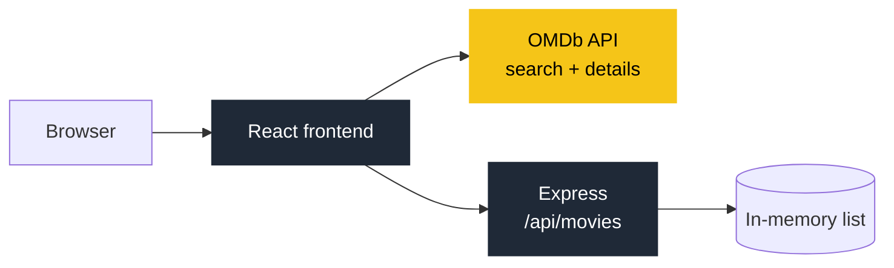
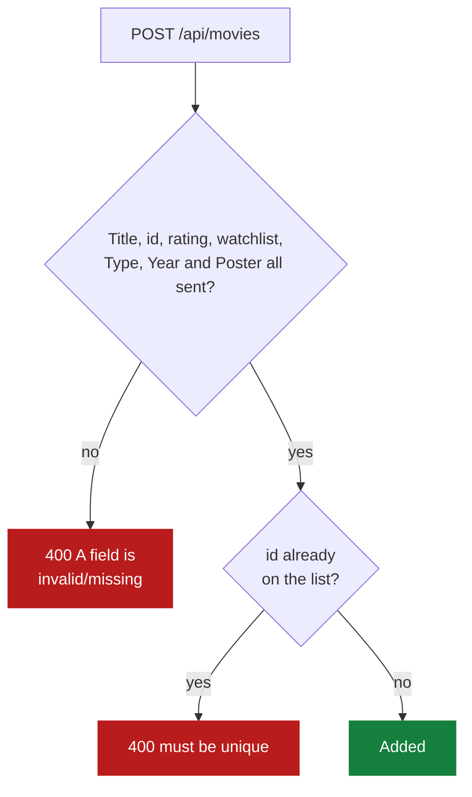
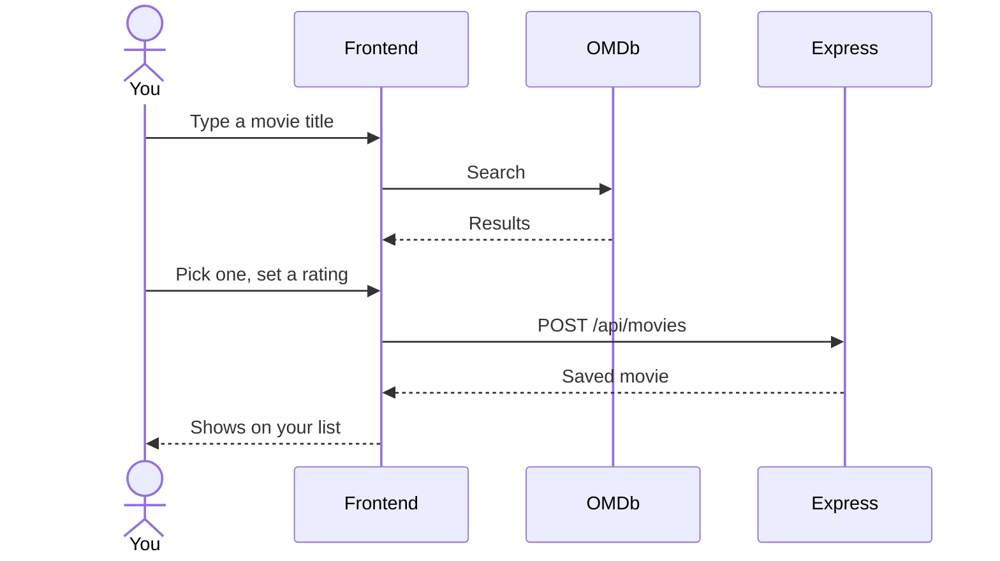

<h1 align="center">Movie WatchList</h1>

<p align="center"><a href="https://moviewatchlist-c6kp.onrender.com"><b>moviewatchlist-c6kp.onrender.com</b></a><br/><sub>Free Render instance: the first load can take a minute while it wakes up.</sub></p>

<p align="center">
  <a href="https://moviewatchlist-c6kp.onrender.com"></a>
  
</p>
<p align="center">
  <a href="https://www.omdbapi.com"></a>
  
  
  
  
</p>

A small full-stack practice app: search movies on OMDb, add them to a list, rate them, and mark the ones you still want to watch. The Express backend serves the built React frontend from `backend/dist`.

## Features

- Search OMDb by title and open a movie's details in a modal.
- Add a movie with a rating, and flag it for your watchlist.
- Edit or remove movies on your list.
- **Note:** the list is kept in the server's memory, so it resets whenever the server restarts.

## How it fits together



Routes: `GET /api/movies`, `GET /api/movies/:id`, `POST /api/movies`, `PUT /api/movies/:id`, `DELETE /api/movies/:id`.

## Adding a movie



`PUT /api/movies/:id` checks the same fields and returns 400 if the id isn't on the list yet.

## Using it



## Run locally

```bash
cd frontend
cp .env.example .env      # set VITE_OMBd_API_key to your OMDb key
npm install
npm run dev               # frontend on Vite's dev server

cd ../backend
npm install
npm run dev               # API on port 3001 (Vite proxies /api to it)
```

`npm run build:ui` in `backend/` builds the frontend into `backend/dist`, which Express serves in production.
